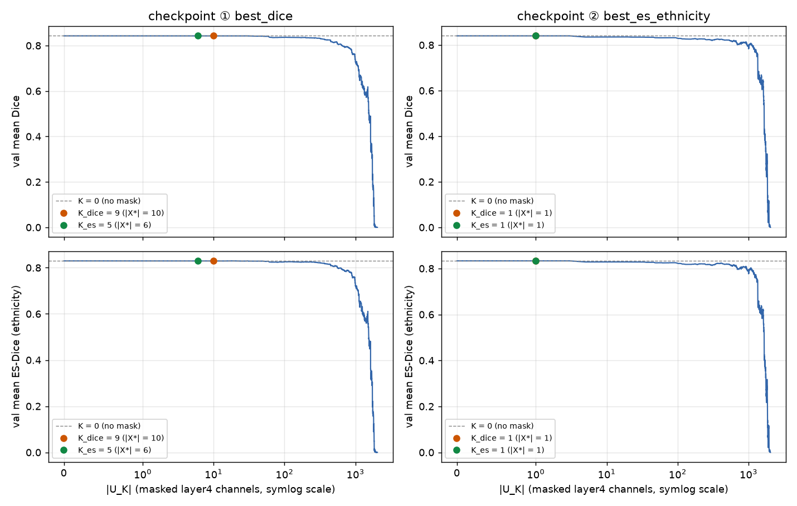

# DeepLabV3+ 公平性實驗結果：ethnicity、I-score + BDA

依 [`spec.md`](spec.md) 與 [`plan.md`](plan.md) Task 10 執行的第一輪結果：DeepLabV3+／ResNet-50 baseline，以及用 I-score + BDA 找出與 ethnicity 相關的 layer4 channels 後遮罩的效果。

- 程式：commit `df98755`（訓練、BDA、test 全部使用同一版，執行時沒有未 commit 的修改，見 `outputs/deeplabv3plus/runs.txt`）
- 資料：Hugging Face `harvardairobotics/FairSeg`；官方 `train.txt` 切成 train 7,000／val 1,000，官方 `test.txt` 2,000 張不動（[`lists/FairSeg_split`](../lists/FairSeg_split)）
- 表格數字由 `outputs/deeplabv3plus/` 的 test JSON、`union_val.csv`，以及 `outputs/baseline_test/results.csv`、`scripts/paper_baselines.csv` 以程式產生，未經人工抄寫

---

## 1. 結論摘要

1. **Baseline 表現接近 SAMed、高於 TransUNet。** checkpoint ①（val 平均 Dice 最高，epoch 33）在 test 上 Cup Dice 0.8647、Rim Dice 0.8223；本 repo 重現的 SAMed 為 0.8630／0.8196，TransUNet 為 0.8482／0.7921（第 4 節）。ethnicity 的 ES-Dice 也與 SAMed 相當（Cup 0.8393 vs 0.8400，Rim 0.8110 vs 0.8070）。
2. **依屬性挑選 checkpoint（②-屬性）沒有帶來一致的公平性改善。** 在 test 上，②-屬性 與 ① 的 ES-Dice 差距都在 ±0.006 以內，有升有降。
3. **遮罩 BDA 選出的 channels 幾乎沒有效果。** 三個遮罩在 test 上的所有指標變動都不超過 0.0004，平均 ES-Dice 只增加 0.00005～0.00014（第 6 節）。和 experiment_001（只遮 1 個 channel、變動約 1e-5）的結論相同：不 fine-tune 時，遮掉少量 layer4 channels 不會改變 ethnicity 的公平性。
4. **遮罩越多，Dice 與 ES-Dice 一起下降，沒有「犧牲 Dice 換公平性」的區段。** 驗證集上沒有任何 K 讓平均 ES-Dice 比不遮罩高出超過 0.0002（第 5 節的圖）。

---

## 2. 切分檢查

`DeepLabv3+/make_split.py` 產生，seed 42。train 7,000、val 1,000，彼此不重疊，聯集等於官方 `train.txt`，val 與 `test.txt` 不重疊。各屬性在 train 與 val 的族群比例（不含 Unknown）：

| 屬性 | 族群 | train 張數 | val 張數 | train 比例 (%) | val 比例 (%) | 差距（百分點） |
|---|---|---|---|---|---|---|
| race | Asian | 657 | 93 | 9.39 | 9.3 | -0.09 |
| race | Black | 1,028 | 146 | 14.69 | 14.6 | -0.09 |
| race | White | 5,315 | 761 | 75.93 | 76.1 | 0.17 |
| gender | Female | 4,039 | 579 | 57.7 | 57.9 | 0.2 |
| gender | Male | 2,961 | 421 | 42.3 | 42.1 | -0.2 |
| ethnicity | Non-Hispanic | 6,348 | 909 | 96.27 | 96.19 | -0.08 |
| ethnicity | Hispanic | 246 | 36 | 3.73 | 3.81 | 0.08 |
| ethnicity | Unknown | 406 | 55 | - | - | - |
| language | English | 6,473 | 927 | 93.47 | 93.35 | -0.12 |
| language | Spanish | 100 | 14 | 1.44 | 1.41 | -0.03 |
| language | Others | 352 | 52 | 5.08 | 5.24 | 0.15 |
| language | Unknown | 75 | 7 | - | - | - |
| maritalstatus | Married | 4,046 | 575 | 59.29 | 58.85 | -0.44 |
| maritalstatus | Not married | 2,778 | 402 | 40.71 | 41.15 | 0.44 |
| maritalstatus | Unknown | 176 | 23 | - | - | - |
| age | <60 | 2,912 | 413 | 41.6 | 41.3 | -0.3 |
| age | >=60 | 4,088 | 587 | 58.4 | 58.7 | 0.3 |

所有屬性的比例差距都不超過 0.44 個百分點（spec §5.3 的模擬上限為 0.5）。val 的 Hispanic 為 36 張。

---

## 3. 訓練與 checkpoint 選擇

| 項目 | 結果 |
|---|---|
| 設定 | spec §8：SGD、lr 0.01 poly、batch 24（單卡）、300 epochs、0.5 CE + 0.5 Dice、seed 42 |
| 時間 | 11/24 10:41 → 18:52，8 小時 10 分（每個 epoch 約 100 秒） |
| 先前中斷的兩次 | 11/23 16:01 開始的一次在 epoch 51 因 Windows 藍屏（0x1A）中斷；11/23 22:24 開始的一次用 DataParallel 雙卡，在 epoch 152 因系統記憶體用盡中斷（spec §8）。兩次的結果都不使用 |
| train loss | epoch 1：0.2164 → epoch 33：0.0848 → epoch 300：0.0389，持續下降 |
| val 平均 Dice | epoch 10：0.8346，epoch 30 前後到 0.8428，之後在 0.834～0.842 之間波動，epoch 300 為 0.8382 |

val 平均 Dice 在 epoch 30 左右就到頂，之後 train loss 繼續下降但 val 沒有進步，屬於輕微的 overfitting。因此 7 個選擇用 checkpoint 大多在 epoch 26～33：

| Checkpoint | 選擇依據（val） | Epoch | 該指標值 | 當時 val 平均 Dice |
|---|---|---|---|---|
| ① best_dice | 平均 Dice | 33 | 0.8428 | 0.8428 |
| ② best_es_race | race 平均 ES-Dice | 31 | 0.7955 | 0.8422 |
| ② best_es_gender | gender 平均 ES-Dice | 26 | 0.8389 | 0.8415 |
| ② best_es_ethnicity | ethnicity 平均 ES-Dice | 204 | 0.8332 | 0.8402 |
| ② best_es_language | language 平均 ES-Dice | 169 | 0.8202 | 0.8387 |
| ② best_es_maritalstatus | marital status 平均 ES-Dice | 33 | 0.8317 | 0.8428 |
| ② best_es_age | age 平均 ES-Dice | 30 | 0.8317 | 0.8428 |

best_es_maritalstatus 和 best_dice 是同一個 epoch，兩個檔案內容完全相同，所以第 4 節 marital status 的兩列數字一樣。

---

## 4. Baseline 的 test 結果（spec §9）

每個區塊中，`(paper)` 為 FairSeg 論文數值，`(ours)` 為本 repo 重現的 SAMed／TransUNet（[`docs/baseline_reproduction.md`](../../docs/baseline_reproduction.md)），**粗體**為 DeepLabV3+。① 在六個屬性用同一次推論，②-屬性只評估各自的屬性。族群名稱依 HF 編碼；論文的 gender 與 ethnicity 欄位疑似對調，說明見 `baseline_reproduction.md`。

**訓練條件不同，比較時要注意：**

| | DeepLabV3+ | SAMed／TransUNet（paper 與 ours） |
|---|---|---|
| 訓練影像 | 7,000（另 1,000 張當 val） | 8,000 |
| 選模型 | 在 val 上選 epoch（① 平均 Dice、②-屬性 ES-Dice） | 最後一個 epoch，沒有 val |
| Loss | 0.5 CE + 0.5 Dice（Dice 分母不平方、不含背景） | TransUNet 0.5 CE + 0.5 Dice（官方算法）；SAMed 0.2 CE + 0.8 Dice |
| 輸入 | 224×224，ImageNet mean／std 正規化 | TransUNet 224；SAMed 512 |

### 4.1 sensitive attribute = race（test 人數：Asian 169, Black 299, White 1,532）

| Region | Method | Overall ES-Dice | Overall Dice | Overall ES-IoU | Overall IoU | Asian Dice | Black Dice | White Dice | Asian IoU | Black IoU | White IoU |
|---|---|---|---|---|---|---|---|---|---|---|---|
| Cup | SAMed (paper) | 0.8532 | 0.8671 | 0.7643 | 0.7813 | 0.8568 | 0.8730 | 0.8670 | 0.7688 | 0.7905 | 0.7808 |
| Cup | SAMed (ours) | 0.8468 | 0.8630 | 0.7613 | 0.7741 | 0.8516 | 0.8576 | 0.8653 | 0.7649 | 0.7686 | 0.7762 |
| Cup | TransUNet (paper) | 0.8281 | 0.8481 | 0.7300 | 0.7532 | 0.8270 | 0.8489 | 0.8503 | 0.7277 | 0.7576 | 0.7551 |
| Cup | TransUNet (ours) | 0.8202 | 0.8482 | 0.7288 | 0.7530 | 0.8269 | 0.8394 | 0.8522 | 0.7331 | 0.7437 | 0.7570 |
| Cup | **DeepLabV3+ ① best_dice（epoch 33）** | 0.8423 | 0.8647 | 0.7559 | 0.7770 | 0.8527 | 0.8536 | 0.8682 | 0.7659 | 0.7638 | 0.7807 |
| Cup | **DeepLabV3+ ② best_es_race（epoch 31）** | 0.8433 | 0.8636 | 0.7565 | 0.7750 | 0.8524 | 0.8539 | 0.8667 | 0.7656 | 0.7633 | 0.7784 |
| Rim | SAMed (paper) | 0.7478 | 0.8291 | 0.6395 | 0.7217 | 0.7890 | 0.7758 | 0.8444 | 0.6743 | 0.6587 | 0.7399 |
| Rim | SAMed (ours) | 0.7584 | 0.8196 | 0.6453 | 0.7064 | 0.7825 | 0.7866 | 0.8302 | 0.6657 | 0.6650 | 0.7190 |
| Rim | TransUNet (paper) | 0.7034 | 0.7927 | 0.5848 | 0.6706 | 0.7457 | 0.7307 | 0.8106 | 0.6160 | 0.5991 | 0.6913 |
| Rim | TransUNet (ours) | 0.7065 | 0.7921 | 0.5861 | 0.6701 | 0.7297 | 0.7487 | 0.8075 | 0.5962 | 0.6188 | 0.6883 |
| Rim | **DeepLabV3+ ① best_dice（epoch 33）** | 0.7535 | 0.8223 | 0.6396 | 0.7108 | 0.7792 | 0.7860 | 0.8342 | 0.6601 | 0.6648 | 0.7254 |
| Rim | **DeepLabV3+ ② best_es_race（epoch 31）** | 0.7524 | 0.8210 | 0.6374 | 0.7089 | 0.7783 | 0.7843 | 0.8328 | 0.6582 | 0.6621 | 0.7236 |

### 4.2 sensitive attribute = gender（test 人數：Male 771, Female 1,229）

| Region | Method | Overall ES-Dice | Overall Dice | Overall ES-IoU | Overall IoU | Male Dice | Female Dice | Male IoU | Female IoU |
|---|---|---|---|---|---|---|---|---|---|
| Cup | SAMed (paper) | 0.8623 | 0.8671 | 0.7757 | 0.7813 | 0.8647 | 0.8703 | 0.7783 | 0.7855 |
| Cup | SAMed (ours) | 0.8551 | 0.8630 | 0.7649 | 0.7741 | 0.8686 | 0.8595 | 0.7816 | 0.7695 |
| Cup | TransUNet (paper) | 0.8435 | 0.8481 | 0.7490 | 0.7532 | 0.8458 | 0.8513 | 0.7508 | 0.7564 |
| Cup | TransUNet (ours) | 0.8396 | 0.8482 | 0.7434 | 0.7530 | 0.8545 | 0.8443 | 0.7610 | 0.7480 |
| Cup | **DeepLabV3+ ① best_dice（epoch 33）** | 0.8569 | 0.8647 | 0.7670 | 0.7770 | 0.8703 | 0.8612 | 0.7849 | 0.7719 |
| Cup | **DeepLabV3+ ② best_es_gender（epoch 26）** | 0.8535 | 0.8609 | 0.7632 | 0.7722 | 0.8663 | 0.8576 | 0.7794 | 0.7676 |
| Rim | SAMed (paper) | 0.8236 | 0.8291 | 0.7158 | 0.7217 | 0.8319 | 0.8252 | 0.7252 | 0.7169 |
| Rim | SAMed (ours) | 0.8184 | 0.8196 | 0.7048 | 0.7064 | 0.8187 | 0.8202 | 0.7050 | 0.7073 |
| Rim | TransUNet (paper) | 0.7882 | 0.7927 | 0.6659 | 0.6706 | 0.7951 | 0.7894 | 0.6736 | 0.6665 |
| Rim | TransUNet (ours) | 0.7856 | 0.7921 | 0.6626 | 0.6701 | 0.7871 | 0.7953 | 0.6631 | 0.6745 |
| Rim | **DeepLabV3+ ① best_dice（epoch 33）** | 0.8219 | 0.8223 | 0.7100 | 0.7108 | 0.8220 | 0.8225 | 0.7101 | 0.7113 |
| Rim | **DeepLabV3+ ② best_es_gender（epoch 26）** | 0.8226 | 0.8235 | 0.7111 | 0.7122 | 0.8228 | 0.8239 | 0.7112 | 0.7128 |

### 4.3 sensitive attribute = preferred language（test 人數：English 1,837, Spanish 40, Others 105）

| Region | Method | Overall ES-Dice | Overall Dice | Overall ES-IoU | Overall IoU | English Dice | Spanish Dice | Others Dice | English IoU | Spanish IoU | Others IoU |
|---|---|---|---|---|---|---|---|---|---|---|---|
| Cup | SAMed (paper) | 0.8186 | 0.8671 | 0.7278 | 0.7813 | 0.8652 | 0.9077 | 0.8838 | 0.7791 | 0.8338 | 0.8001 |
| Cup | SAMed (ours) | 0.8376 | 0.8630 | 0.7460 | 0.7741 | 0.8635 | 0.8834 | 0.8536 | 0.7745 | 0.8028 | 0.7655 |
| Cup | TransUNet (paper) | 0.8037 | 0.8481 | 0.7033 | 0.7532 | 0.8469 | 0.8972 | 0.8531 | 0.7516 | 0.8166 | 0.7592 |
| Cup | TransUNet (ours) | 0.8220 | 0.8482 | 0.7274 | 0.7530 | 0.8499 | 0.8537 | 0.8235 | 0.7546 | 0.7633 | 0.7297 |
| Cup | **DeepLabV3+ ① best_dice（epoch 33）** | 0.8327 | 0.8647 | 0.7444 | 0.7770 | 0.8658 | 0.8819 | 0.8447 | 0.7780 | 0.7999 | 0.7573 |
| Cup | **DeepLabV3+ ② best_es_language（epoch 169）** | 0.8276 | 0.8591 | 0.7349 | 0.7693 | 0.8600 | 0.8793 | 0.8421 | 0.7702 | 0.7963 | 0.7505 |
| Rim | SAMed (paper) | 0.7852 | 0.8291 | 0.6800 | 0.7217 | 0.8305 | 0.8534 | 0.7989 | 0.7234 | 0.7468 | 0.6871 |
| Rim | SAMed (ours) | 0.7962 | 0.8196 | 0.6849 | 0.7064 | 0.8215 | 0.8241 | 0.7964 | 0.7082 | 0.7136 | 0.6840 |
| Rim | TransUNet (paper) | 0.7517 | 0.7927 | 0.6346 | 0.6706 | 0.7940 | 0.8165 | 0.7633 | 0.6721 | 0.6950 | 0.6398 |
| Rim | TransUNet (ours) | 0.7548 | 0.7921 | 0.6357 | 0.6701 | 0.7952 | 0.7861 | 0.7518 | 0.6736 | 0.6630 | 0.6265 |
| Rim | **DeepLabV3+ ① best_dice（epoch 33）** | 0.7946 | 0.8223 | 0.6854 | 0.7108 | 0.8248 | 0.8204 | 0.7917 | 0.7135 | 0.7082 | 0.6790 |
| Rim | **DeepLabV3+ ② best_es_language（epoch 169）** | 0.7926 | 0.8209 | 0.6803 | 0.7085 | 0.8234 | 0.8177 | 0.7909 | 0.7114 | 0.7038 | 0.6746 |

### 4.4 sensitive attribute = ethnicity（test 人數：Hispanic 90, Non-Hispanic 1,803）

| Region | Method | Overall ES-Dice | Overall Dice | Overall ES-IoU | Overall IoU | Hispanic Dice | Non-Hispanic Dice | Hispanic IoU | Non-Hispanic IoU |
|---|---|---|---|---|---|---|---|---|---|
| Cup | SAMed (paper) | 0.8459 | 0.8671 | 0.7578 | 0.7813 | 0.8653 | 0.8904 | 0.7790 | 0.8100 |
| Cup | SAMed (ours) | 0.8400 | 0.8630 | 0.7461 | 0.7741 | 0.8884 | 0.8610 | 0.8091 | 0.7715 |
| Cup | TransUNet (paper) | 0.8281 | 0.8481 | 0.7300 | 0.7532 | 0.8463 | 0.8704 | 0.7508 | 0.7826 |
| Cup | TransUNet (ours) | 0.8206 | 0.8482 | 0.7223 | 0.7530 | 0.8791 | 0.8454 | 0.7921 | 0.7496 |
| Cup | **DeepLabV3+ ① best_dice（epoch 33）** | 0.8393 | 0.8647 | 0.7461 | 0.7770 | 0.8927 | 0.8625 | 0.8155 | 0.7741 |
| Cup | **DeepLabV3+ ② best_es_ethnicity（epoch 204）** | 0.8399 | 0.8635 | 0.7474 | 0.7750 | 0.8896 | 0.8614 | 0.8094 | 0.7724 |
| Rim | SAMed (paper) | 0.8193 | 0.8291 | 0.7143 | 0.7217 | 0.8277 | 0.8397 | 0.7203 | 0.7307 |
| Rim | SAMed (ours) | 0.8070 | 0.8196 | 0.6953 | 0.7064 | 0.8349 | 0.8192 | 0.7221 | 0.7061 |
| Rim | TransUNet (paper) | 0.7815 | 0.7927 | 0.6626 | 0.6706 | 0.7914 | 0.8057 | 0.6695 | 0.6815 |
| Rim | TransUNet (ours) | 0.7832 | 0.7921 | 0.6634 | 0.6701 | 0.8031 | 0.7917 | 0.6801 | 0.6699 |
| Rim | **DeepLabV3+ ① best_dice（epoch 33）** | 0.8110 | 0.8223 | 0.7006 | 0.7108 | 0.8356 | 0.8216 | 0.7248 | 0.7101 |
| Rim | **DeepLabV3+ ② best_es_ethnicity（epoch 204）** | 0.8120 | 0.8203 | 0.7020 | 0.7080 | 0.8299 | 0.8198 | 0.7160 | 0.7075 |

### 4.5 sensitive attribute = marital status（test 人數：Married 1,150, Not married 815）

| Region | Method | Overall ES-Dice | Overall Dice | Overall ES-IoU | Overall IoU | Married Dice | Not married Dice | Married IoU | Not married IoU |
|---|---|---|---|---|---|---|---|---|---|
| Cup | **DeepLabV3+ ① best_dice（epoch 33）** | 0.8597 | 0.8647 | 0.7718 | 0.7770 | 0.8624 | 0.8682 | 0.7744 | 0.7810 |
| Cup | **DeepLabV3+ ② best_es_maritalstatus（epoch 33）** | 0.8597 | 0.8647 | 0.7718 | 0.7770 | 0.8624 | 0.8682 | 0.7744 | 0.7810 |
| Rim | **DeepLabV3+ ① best_dice（epoch 33）** | 0.8216 | 0.8223 | 0.7100 | 0.7108 | 0.8221 | 0.8230 | 0.7114 | 0.7103 |
| Rim | **DeepLabV3+ ② best_es_maritalstatus（epoch 33）** | 0.8216 | 0.8223 | 0.7100 | 0.7108 | 0.8221 | 0.8230 | 0.7114 | 0.7103 |

### 4.6 sensitive attribute = age（test 人數：<60 855, >=60 1,145）

| Region | Method | Overall ES-Dice | Overall Dice | Overall ES-IoU | Overall IoU | <60 Dice | >=60 Dice | <60 IoU | >=60 IoU |
|---|---|---|---|---|---|---|---|---|---|
| Cup | **DeepLabV3+ ① best_dice（epoch 33）** | 0.8641 | 0.8647 | 0.7766 | 0.7770 | 0.8643 | 0.8649 | 0.7767 | 0.7772 |
| Cup | **DeepLabV3+ ② best_es_age（epoch 30）** | 0.8616 | 0.8622 | 0.7730 | 0.7730 | 0.8618 | 0.8624 | 0.7730 | 0.7730 |
| Rim | **DeepLabV3+ ① best_dice（epoch 33）** | 0.8111 | 0.8223 | 0.6985 | 0.7108 | 0.8302 | 0.8164 | 0.7210 | 0.7033 |
| Rim | **DeepLabV3+ ② best_es_age（epoch 30）** | 0.8124 | 0.8234 | 0.6999 | 0.7121 | 0.8312 | 0.8177 | 0.7221 | 0.7047 |

**小結。** 整體 Dice 方面，DeepLabV3+ 的 Cup 與 SAMed 相當，Rim 略高於本 repo 重現的 SAMed（低於論文的 SAMed）；兩者都明顯高於 TransUNet。公平性方面，各屬性的 ES-Dice 大致和 SAMed 同一水準，族群間的差距方向也相同（例如 race 的 Rim 都是 White 最高；ethnicity 都是 Hispanic 較高）。age 與 marital status 的族群差距很小（族群間 Dice 差距不超過 0.014），ES-Dice 接近整體 Dice。

---

## 5. I-score + BDA（spec §10）

對 checkpoint ① 和 ②-ethnicity 各做一次，兩次獨立。val 1,000 張中排除 ethnicity Unknown 的 55 張，945 張參與 I-score（Hispanic 36 張）。

| | ① best_dice（epoch 33） | ②-ethnicity（epoch 204） |
|---|---|---|
| BDA 次數（seed 42） | 10,000 | 10,000 |
| 不同的最終 subset | 5,885 | 6,054 |
| 最終 subset 大小（1／2／3 個 channel） | 1,007／3,495／1,383 | 956／3,784／1,314 |
| I-score 最高的 subset | {2013}，I = 7.0127 | {408}，I = 9.7893 |
| 評估的聯集數（不含 K = 0） | 1,627 | 1,642 |
| 執行時間 | 88 分鐘 | 89 分鐘 |
| 快取路徑檢查（spec §13） | 通過：不遮罩時逐張 cup／rim Dice 與完整模型完全相同 | 通過 |

### 5.1 K 對驗證集的曲線

橫軸為聯集 U_K 的 channel 數（symlog 刻度），虛線為不遮罩。兩個 checkpoint 的形狀相近：① 遮罩約 50 個 channel 以內兩個指標幾乎不變；② 在遮罩 3 → 5 個 channel 時先掉約 0.005，之後到數百個都大致持平。遮罩數百個以後，Dice 與 ES-Dice 一起下降；遮滿約 2,000 個時預測幾乎全空（Dice 接近 0）。ES-Dice 曲線和 Dice 曲線幾乎平行，代表遮罩主要是讓所有族群一起變差，而不是縮小族群差距。

**① best_dice**：

| 目標 \|U_K\| | K | 實際 \|U_K\| | val 平均 Dice | val 平均 ES-Dice |
|---|---|---|---|---|
| 0 | 0 | 0 | 0.8428 | 0.8296 |
| 1 | 1 | 1 | 0.8428 | 0.8296 |
| 5 | 4 | 5 | 0.8428 | 0.8297 |
| 10 | 9 | 10 | 0.8428 | 0.8293 |
| 20 | 14 | 20 | 0.8426 | 0.8295 |
| 50 | 39 | 49 | 0.8416 | 0.8287 |
| 100 | 71 | 99 | 0.8362 | 0.8252 |
| 200 | 168 | 199 | 0.8343 | 0.8245 |
| 500 | 488 | 500 | 0.8130 | 0.8057 |
| 1000 | 1185 | 999 | 0.7276 | 0.7212 |
| 1500 | 2056 | 1500 | 0.6176 | 0.6104 |
| 2000 | 4959 | 2000 | 0.0007 | 0.0007 |

**②-ethnicity**：

| 目標 \|U_K\| | K | 實際 \|U_K\| | val 平均 Dice | val 平均 ES-Dice |
|---|---|---|---|---|
| 0 | 0 | 0 | 0.8402 | 0.8332 |
| 1 | 1 | 1 | 0.8403 | 0.8332 |
| 5 | 3 | 5 | 0.8350 | 0.8284 |
| 10 | 8 | 9 | 0.8350 | 0.8284 |
| 20 | 17 | 20 | 0.8354 | 0.8285 |
| 50 | 47 | 49 | 0.8319 | 0.8248 |
| 100 | 83 | 99 | 0.8304 | 0.8235 |
| 200 | 187 | 200 | 0.8267 | 0.8200 |
| 500 | 514 | 500 | 0.8215 | 0.8186 |
| 1000 | 1119 | 1000 | 0.7837 | 0.7770 |
| 1500 | 2065 | 1500 | 0.6297 | 0.6045 |
| 2000 | 4689 | 2000 | 0.0046 | 0.0046 |

### 5.2 選出的 K

| Checkpoint | K_Dice | \|X*\| | K_ES | \|X*\| | 與不遮罩相比（val） |
|---|---|---|---|---|---|
| ① | 9 | 10 | 5 | 6 | 平均 Dice +0.00004（K_Dice）；平均 ES-Dice +0.0002（K_ES） |
| ②-ethnicity | 1 | 1 | 1 | 1 | 平均 Dice +0.00001；平均 ES-Dice +0.00005 |

- ① 的 X*：K_Dice = {494, 591, 729, 785, 895, 964, 1192, 1551, 1764, 2013}；K_ES = {591, 785, 895, 1192, 1551, 2013}。
- ②-ethnicity 的 X*：{408}。K_Dice = K_ES，依 spec §10.7 只跑一次 test。
- 兩個 checkpoint 都沒有選到 K = 0，但選出的 K 在 val 上的改善都小於 0.0003，和 K = 0 的差距落在雜訊範圍內。

---

## 6. 遮罩前後的 ethnicity test 結果（spec §10.7、§11）

val 與 test 並列。「平均」為 (Cup + Rim) / 2；ES-Dice 皆為 ethnicity。

| Checkpoint | 遮罩 | K | \|X*\| | val 平均 Dice | val 平均 ES-Dice | test 平均 Dice | test 平均 ES-Dice | test Cup Dice | test Rim Dice | test Cup ES-Dice | test Rim ES-Dice | test Hispanic Cup/Rim Dice | test Non-Hispanic Cup/Rim Dice |
|---|---|---|---|---|---|---|---|---|---|---|---|---|---|
| ① | 不遮罩 | 0 | 0 | 0.8428 | 0.8296 | 0.8435 | 0.8252 | 0.8647 | 0.8223 | 0.8393 | 0.8110 | 0.8927 / 0.8356 | 0.8625 / 0.8216 |
| ① | K_dice | 9 | 10 | 0.8428 | 0.8293 | 0.8437 | 0.8253 | 0.8647 | 0.8227 | 0.8393 | 0.8113 | 0.8927 / 0.8361 | 0.8625 / 0.8220 |
| ① | K_es | 5 | 6 | 0.8428 | 0.8298 | 0.8436 | 0.8252 | 0.8646 | 0.8225 | 0.8393 | 0.8112 | 0.8927 / 0.8358 | 0.8625 / 0.8218 |
| ②-ethnicity | 不遮罩 | 0 | 0 | 0.8402 | 0.8332 | 0.8419 | 0.8260 | 0.8635 | 0.8203 | 0.8399 | 0.8120 | 0.8896 / 0.8299 | 0.8614 / 0.8198 |
| ②-ethnicity | K_dice | 1 | 1 | 0.8403 | 0.8332 | 0.8419 | 0.8260 | 0.8635 | 0.8203 | 0.8400 | 0.8121 | 0.8895 / 0.8299 | 0.8615 / 0.8198 |
| ②-ethnicity | K_es（= K_dice，沿用上一列） | 1 | 1 | 0.8403 | 0.8332 | 0.8419 | 0.8260 | 0.8635 | 0.8203 | 0.8400 | 0.8121 | 0.8895 / 0.8299 | 0.8615 / 0.8198 |

與各自不遮罩相比，test 上的變化：

| 遮罩 | 平均 Dice | 平均 ES-Dice | Cup Dice | Rim Dice | Cup ES-Dice | Rim ES-Dice |
|---|---|---|---|---|---|---|
| ① K_Dice（10 個 channel） | +0.00017 | +0.00014 | −0.00003 | +0.00037 | +0.00001 | +0.00027 |
| ① K_ES（6 個 channel） | +0.00007 | +0.00005 | −0.00004 | +0.00017 | −0.00006 | +0.00016 |
| ②-ethnicity K_Dice = K_ES（1 個 channel） | +0.00002 | +0.00008 | +0.00002 | +0.00003 | +0.00010 | +0.00005 |

所有變化都在 0.0004 以內，遠小於族群之間的差距（例如 Cup 的 Hispanic 與 Non-Hispanic 相差約 0.03），也小於 ② 與 ① 兩個 checkpoint 之間的差距。**這一輪的結論是：在不 fine-tune 的情況下，以 I-score + BDA 選出並遮罩 layer4 channels，對 ethnicity 的公平性沒有可量測的影響。**

風險說明（spec §10.7）：val 只有 36 張 Hispanic，K_ES 是從約 1,600 個候選遮罩中挑出 val ES-Dice 最高的一個。這一輪 val 上的改善本身就很小，test 上也沒有出現較大的改善，所以沒有「val 改善、test 不成立」的落差需要解釋。

**小差異說明。** 第 3 節的 val 數字來自訓練時的驗證；第 5、6 節的 val 數字由 `bda.py` 重新推論，該程式關閉了 TF32。兩者在 Dice 上相同到小數第 4 位，ES-Dice 最多相差 0.0002（① 的 ethnicity 平均 ES-Dice：訓練時 0.8298，`bda.py` 0.8296）。

---

## 7. 檔案

| 位置 | 內容 |
|---|---|
| `outputs/deeplabv3plus/runs.txt` | 每次執行的 commit、指令、開始與結束時間、exit code |
| `outputs/deeplabv3plus/train_seed42/` | `epochs.csv`（每個 epoch 的 loss 與 val 指標）、7 個 checkpoint、`args.json`、`log.txt` |
| `outputs/deeplabv3plus/bda_dice/`、`bda_es_ethnicity/` | `medians.npy`、`bda_runs.json`（10,000 次 BDA 的過程）、`ranked.json`、`union_val.csv`、`selection.json` |
| `outputs/deeplabv3plus/test/` | 10 次 test 評估的 JSON（Cup／Rim 的 Dice、IoU、ES-Dice、ES-IoU 與各族群分數） |
| `DeepLabv3+/docs/figures/union_val_ethnicity.png` | 第 5.1 節的圖 |

`outputs/` 的內容不在 git 中，說明見 `outputs/README.md`。
