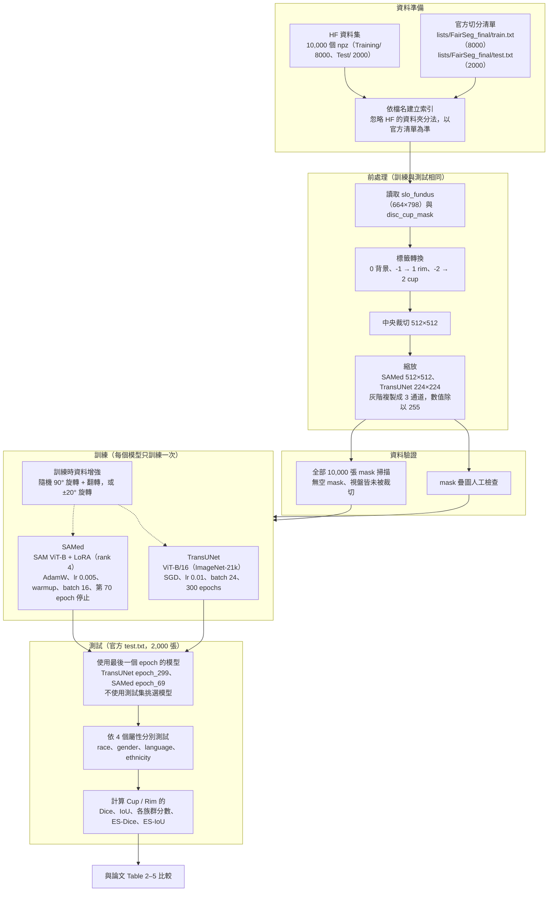

# FairSeg Baseline 重現：SAMed 與 TransUNet

重現論文 *FairSeg: A Large-Scale Medical Image Segmentation Dataset for Fairness Learning Using Segment Anything Model with Fair Error-Bound Scaling*（ICLR 2024，[arXiv:2311.02189](https://arxiv.org/abs/2311.02189)）Table 2–5 中的 SAMed 與 TransUNet baseline。

- 程式：本 repo（fork 自 [Harvard-Ophthalmology-AI-Lab/FairSeg](https://github.com/Harvard-Ophthalmology-AI-Lab/FairSeg)）
- 資料：[Hugging Face harvardairobotics/FairSeg](https://huggingface.co/datasets/harvardairobotics/FairSeg)，依官方 `lists/FairSeg_final` 切分
- 表格數字由 `scripts/summarize_tests.py` 從測試 log 與 `scripts/paper_baselines.csv` 自動產生，未經人工抄寫

---

## 1. 結果：論文 Table 2–5 與本實驗對照

每個區塊中，`(paper)` 為論文數值，**`(ours)`** 為本實驗結果。欄位與族群順序依論文原表。

### Table 2：sensitive attribute = race

| Region | Method | Overall ES-Dice | Overall Dice | Overall ES-IoU | Overall IoU | Asian Dice | Black Dice | White Dice | Asian IoU | Black IoU | White IoU |
|---|---|---|---|---|---|---|---|---|---|---|---|
| Cup | SAMed (paper) | 0.8532 | 0.8671 | 0.7643 | 0.7813 | 0.8568 | 0.8730 | 0.8670 | 0.7688 | 0.7905 | 0.7808 |
| Cup | **SAMed (ours)** | 0.8468 | 0.8630 | 0.7613 | 0.7741 | 0.8516 | 0.8576 | 0.8653 | 0.7649 | 0.7686 | 0.7762 |
| Cup | TransUNet (paper) | 0.8281 | 0.8481 | 0.7300 | 0.7532 | 0.8270 | 0.8489 | 0.8503 | 0.7277 | 0.7576 | 0.7551 |
| Cup | **TransUNet (ours)** | 0.8202 | 0.8482 | 0.7288 | 0.7530 | 0.8269 | 0.8394 | 0.8522 | 0.7331 | 0.7437 | 0.7570 |
| Rim | SAMed (paper) | 0.7478 | 0.8291 | 0.6395 | 0.7217 | 0.7890 | 0.7758 | 0.8444 | 0.6743 | 0.6587 | 0.7399 |
| Rim | **SAMed (ours)** | 0.7584 | 0.8196 | 0.6453 | 0.7064 | 0.7825 | 0.7866 | 0.8302 | 0.6657 | 0.6650 | 0.7190 |
| Rim | TransUNet (paper) | 0.7034 | 0.7927 | 0.5848 | 0.6706 | 0.7457 | 0.7307 | 0.8106 | 0.6160 | 0.5991 | 0.6913 |
| Rim | **TransUNet (ours)** | 0.7065 | 0.7921 | 0.5861 | 0.6701 | 0.7297 | 0.7487 | 0.8075 | 0.5962 | 0.6188 | 0.6883 |

### Table 3：sensitive attribute = gender

| Region | Method | Overall ES-Dice | Overall Dice | Overall ES-IoU | Overall IoU | Male Dice | Female Dice | Male IoU | Female IoU |
|---|---|---|---|---|---|---|---|---|---|
| Cup | SAMed (paper) | 0.8623 | 0.8671 | 0.7757 | 0.7813 | 0.8647 | 0.8703 | 0.7783 | 0.7855 |
| Cup | **SAMed (ours)** | 0.8551 | 0.8630 | 0.7649 | 0.7741 | 0.8686 | 0.8595 | 0.7816 | 0.7695 |
| Cup | TransUNet (paper) | 0.8435 | 0.8481 | 0.7490 | 0.7532 | 0.8458 | 0.8513 | 0.7508 | 0.7564 |
| Cup | **TransUNet (ours)** | 0.8396 | 0.8482 | 0.7434 | 0.7530 | 0.8545 | 0.8443 | 0.7610 | 0.7480 |
| Rim | SAMed (paper) | 0.8236 | 0.8291 | 0.7158 | 0.7217 | 0.8319 | 0.8252 | 0.7252 | 0.7169 |
| Rim | **SAMed (ours)** | 0.8184 | 0.8196 | 0.7048 | 0.7064 | 0.8187 | 0.8202 | 0.7050 | 0.7073 |
| Rim | TransUNet (paper) | 0.7882 | 0.7927 | 0.6659 | 0.6706 | 0.7951 | 0.7894 | 0.6736 | 0.6665 |
| Rim | **TransUNet (ours)** | 0.7856 | 0.7921 | 0.6626 | 0.6701 | 0.7871 | 0.7953 | 0.6631 | 0.6745 |

### Table 4：sensitive attribute = preferred language

| Region | Method | Overall ES-Dice | Overall Dice | Overall ES-IoU | Overall IoU | English Dice | Spanish Dice | Others Dice | English IoU | Spanish IoU | Others IoU |
|---|---|---|---|---|---|---|---|---|---|---|---|
| Cup | SAMed (paper) | 0.8186 | 0.8671 | 0.7278 | 0.7813 | 0.8652 | 0.9077 | 0.8838 | 0.7791 | 0.8338 | 0.8001 |
| Cup | **SAMed (ours)** | 0.8376 | 0.8630 | 0.7460 | 0.7741 | 0.8635 | 0.8834 | 0.8536 | 0.7745 | 0.8028 | 0.7655 |
| Cup | TransUNet (paper) | 0.8037 | 0.8481 | 0.7033 | 0.7532 | 0.8469 | 0.8972 | 0.8531 | 0.7516 | 0.8166 | 0.7592 |
| Cup | **TransUNet (ours)** | 0.8220 | 0.8482 | 0.7274 | 0.7530 | 0.8499 | 0.8537 | 0.8235 | 0.7546 | 0.7633 | 0.7297 |
| Rim | SAMed (paper) | 0.7852 | 0.8291 | 0.6800 | 0.7217 | 0.8305 | 0.8534 | 0.7989 | 0.7234 | 0.7468 | 0.6871 |
| Rim | **SAMed (ours)** | 0.7962 | 0.8196 | 0.6849 | 0.7064 | 0.8215 | 0.8241 | 0.7964 | 0.7082 | 0.7136 | 0.6840 |
| Rim | TransUNet (paper) | 0.7517 | 0.7927 | 0.6346 | 0.6706 | 0.7940 | 0.8165 | 0.7633 | 0.6721 | 0.6950 | 0.6398 |
| Rim | **TransUNet (ours)** | 0.7548 | 0.7921 | 0.6357 | 0.6701 | 0.7952 | 0.7861 | 0.7518 | 0.6736 | 0.6630 | 0.6265 |

### Table 5：sensitive attribute = ethnicity

| Region | Method | Overall ES-Dice | Overall Dice | Overall ES-IoU | Overall IoU | Hispanic Dice | Non-Hispanic Dice | Hispanic IoU | Non-Hispanic IoU |
|---|---|---|---|---|---|---|---|---|---|
| Cup | SAMed (paper) | 0.8459 | 0.8671 | 0.7578 | 0.7813 | 0.8653 | 0.8904 | 0.7790 | 0.8100 |
| Cup | **SAMed (ours)** | 0.8400 | 0.8630 | 0.7461 | 0.7741 | 0.8884 | 0.8610 | 0.8091 | 0.7715 |
| Cup | TransUNet (paper) | 0.8281 | 0.8481 | 0.7300 | 0.7532 | 0.8463 | 0.8704 | 0.7508 | 0.7826 |
| Cup | **TransUNet (ours)** | 0.8206 | 0.8482 | 0.7223 | 0.7530 | 0.8791 | 0.8454 | 0.7921 | 0.7496 |
| Rim | SAMed (paper) | 0.8193 | 0.8291 | 0.7143 | 0.7217 | 0.8277 | 0.8397 | 0.7203 | 0.7307 |
| Rim | **SAMed (ours)** | 0.8070 | 0.8196 | 0.6953 | 0.7064 | 0.8349 | 0.8192 | 0.7221 | 0.7061 |
| Rim | TransUNet (paper) | 0.7815 | 0.7927 | 0.6626 | 0.6706 | 0.7914 | 0.8057 | 0.6695 | 0.6815 |
| Rim | **TransUNet (ours)** | 0.7832 | 0.7921 | 0.6634 | 0.6701 | 0.8031 | 0.7917 | 0.6801 | 0.6699 |

### 表格說明

**族群名稱的對應。** 本實驗的族群名稱依 HF 資料集說明的編碼：gender 0 = Female、1 = Male；ethnicity 0 = Non-Hispanic、1 = Hispanic、-1 = Unknown；race 0 = Asian、1 = Black、2 = White；language 0 = English、1 = Spanish、2 = Others、-1 = Unknown。屬性為 Unknown（-1）的影像只計入整體分數，不計入任何族群（官方程式的做法）。

**論文的 gender 與 ethnicity 欄位疑似對調。** 依上述編碼，本實驗與論文在這兩張表的族群欄位方向相反，但兩欄互換後數值非常接近，例如：

- Table 5 SAMed Cup Dice：ours Non-Hispanic 0.8610 / Hispanic 0.8884；paper「Hispanic」0.8653 /「Non-Hispanic」0.8904
- Table 3 TransUNet Rim Dice：ours Male 0.7871 / Female 0.7953；paper「Male」0.7951 /「Female」0.7894

另外，Non-Hispanic 佔測試集約 90%，整體 Dice 理應接近 Non-Hispanic 的分數。在本實驗中確實如此（0.8630 vs 0.8610），但論文的整體 Dice（0.8671）反而接近標為「Hispanic」的欄位（0.8653）。可能是論文或作者原始資料使用了不同的編碼，本實驗無法確定。

**小族群的分數變動較大。** 測試集（2,000 張）各族群人數如下。Spanish（40 張）與 Hispanic（90 張）樣本很少，少數影像就會讓族群分數變動好幾個百分點，ES 指標也會跟著受影響。

| 屬性 | 測試集各族群人數 |
|---|---|
| race | White 1,532 / Black 299 / Asian 169 |
| gender | Female 1,229 / Male 771 |
| language | English 1,837 / Others 105 / Spanish 40 / Unknown 18 |
| ethnicity | Non-Hispanic 1,803 / Hispanic 90 / Unknown 107 |

**整體結果摘要。**

| 模型 | Cup Dice（ours / paper） | Rim Dice（ours / paper） |
|---|---|---|
| TransUNet | 0.8482 / 0.8481（+0.0001） | 0.7921 / 0.7927（−0.0006） |
| SAMed | 0.8630 / 0.8671（−0.0041） | 0.8196 / 0.8291（−0.0095） |

TransUNet 的整體指標與論文幾乎一致。SAMed 低約 0.4～1 個百分點，最可能的原因是 batch size（本實驗 16，官方 48，見第 3 節），但模型排名（SAMed > TransUNet）與論文相同。

---

## 2. 實驗流程

開始正式訓練前，先完成了以下驗證：

1. 用 16 張影像試訓練，確認兩個模型的 loss 會下降
2. 測量不同 batch size 的顯存用量與速度
3. 用完整資料各跑一個 epoch，確認流程可以完整跑通

TransUNet 共訓練了三次：前兩次因 PyTorch 在 Windows 上存檔失敗而沒有留下最終模型，第三次改用新的存檔方式後成功。三次的訓練設定完全相同，第 1 步的 loss 也一模一樣（0.752602）。

---

## 3. 實驗設定與官方比較

「官方」欄中，**程式**指官方 GitHub 的 `train.sh` 與 `train.py` 預設值，**論文**指論文第 5 節的描述。兩者不一致時，本實驗依照程式。

比較欄符號：✅ 相同、⚠️ 不同（說明見欄內）、➖ 官方未說明。

### 3.1 資料與前處理（兩個模型共用）

| 項目 | 本實驗 | 官方 | 比較 |
|---|---|---|---|
| 資料來源 | Hugging Face `harvardairobotics/FairSeg` | 作者提供的 Google Drive 版本 | ⚠️ 同一份資料的不同發佈版本：HF 版的欄位名稱不同（`slo_fundus`、`disc_cup_mask`、`ethnicity`）且沒有 `pid` |
| 訓練／測試切分 | 官方 `lists/FairSeg_final`：8,000／2,000 | 同左（論文：8,000／2,000，patient-level split） | ✅ |
| 驗證集 | 無 | 無 | ✅ |
| 影像 | SLO 眼底影像，664×798，灰階 | 同左 | ✅ |
| 標籤 | 0 背景、1 rim（原值 -1）、2 cup（原值 -2） | 同左 | ✅ |
| 前處理 | 中央裁切 512×512 → 縮放到模型輸入大小，數值除以 255，灰階複製成 3 通道 | 同左 | ✅ |
| 資料增強 | 50% 機率做隨機 90° 旋轉加翻轉；否則再以 50% 機率做 ±20° 旋轉 | 同左 | ✅ |
| 屬性編碼 | race 0/1/2；gender 0 F / 1 M；年齡單位為「年」 | 舊版：race 2/3/7；年齡單位為「天」 | ⚠️ 已修改程式以讀取 HF 版編碼，讀到的內容相同 |
| 隨機種子 | 1234，cuDNN deterministic | 同左 | ✅ |

### 3.2 TransUNet 訓練

| 項目 | 本實驗 | 官方 | 比較 |
|---|---|---|---|
| 架構 | ViT-B/16，無 CNN skip（`n_skip 0`） | 程式：同左；論文：standard ViT-B | ✅ |
| 預訓練權重 | ImageNet-21k `ViT-B_16.npz` | 同左 | ✅ |
| 輸入大小 | 224×224 | 程式：224 | ✅ |
| 類別數 | 3（背景、rim、cup） | 3 | ✅ |
| Loss | 0.5 × CE + 0.5 × Dice | 程式：同左；論文：CE + Dice（未給權重） | ✅ |
| Optimizer | SGD，momentum 0.9 | 程式：SGD，momentum 0.9；論文：AdamW | ⚠️ 依程式 |
| Learning rate | 0.01 | 程式：0.01；論文：0.01 | ✅ |
| 學習率排程 | 多項式衰減，power 0.9（共 100,200 步） | 程式：同左；論文：指數衰減 | ⚠️ 依程式 |
| Weight decay | 1e-4 | 程式：1e-4；論文：1e-4 | ✅ |
| Batch size | 24（2 張 GPU × 12，DataParallel） | 程式：24（1 張 GPU）；論文：42 | ⚠️ 合計 batch 與程式相同；BatchNorm 為每張 GPU 各用 12 張影像計算統計值 |
| Epochs | 300 | 程式：300；論文：300 | ✅ |
| 每個 epoch 步數 | 334 | 程式：334 | ✅ |
| 屬性與訓練 | 訓練一次，四個屬性共用 | `train.sh` 對每個屬性各訓練一次 | ⚠️ baseline 訓練不使用屬性，結果等價 |
| 測試用模型 | 最後一個 epoch（`epoch_299.pth`） | 程式：`best_model.pth`，不存在時用最後一個 epoch | ✅ 程式不會產生 `best_model.pth`，實際上就是最後一個 epoch |
| 訓練時間 | 13.7 小時 | ➖ | ➖ |

### 3.3 SAMed 訓練

| 項目 | 本實驗 | 官方 | 比較 |
|---|---|---|---|
| 架構 | SAM ViT-B，image encoder 加 LoRA（rank 4，作用在 q、v），不使用 prompt | 同左 | ✅ |
| 預訓練權重 | `sam_vit_b_01ec64.pth`（SHA256 與 SAM 官方一致） | 同左 | ✅ |
| 可訓練參數 | 約 407 萬（LoRA、prompt encoder、mask decoder） | 同左 | ✅ |
| 輸入大小 | 512×512；loss 在 128×128 的低解析度輸出上計算 | 同左 | ✅ |
| 類別數 | 2（另加背景） | 2 | ✅ |
| Loss | 0.2 × CE + 0.8 × Dice | 程式：同左；論文：CE + Dice（未給權重） | ✅ |
| Optimizer | AdamW，betas (0.9, 0.999) | 程式：同左；論文：AdamW | ✅ |
| Learning rate | 0.005 | 程式：0.005；論文：0.005 | ✅ |
| Warmup | 前 250 步線性增加 | 程式：同左；論文：未提 | ✅ |
| 學習率排程 | warmup 後多項式衰減，power 0.9（以 100 epochs 計算） | 程式：同左；論文：指數衰減 | ⚠️ 依程式 |
| Weight decay | 0.1 | 程式：0.1；論文：0.1 | ✅ |
| Batch size | **16**（2 張 GPU × 8） | 程式：**48**（2 張 GPU × 24）；論文：42 | ⚠️ **12 GB 顯卡最多放得下每張 8**。學習率沒有跟著調整。這是 SAMed 結果與論文差距最可能的原因 |
| 每個 epoch 步數 | 500 | 程式：約 167 | ⚠️ batch 較小，每個 epoch 的步數較多 |
| Epochs | 最多 100，第 70 epoch 停止 | 程式：同左；論文：130 epochs，第 70 epoch 提早停止 | ✅ 實際都訓練 70 epochs |
| 屬性與訓練 | 訓練一次，四個屬性共用 | `train.sh` 對每個屬性各訓練一次 | ⚠️ baseline 訓練不使用屬性，結果等價 |
| 測試用模型 | 最後一個 epoch（`epoch_69.pth`） | 程式：由使用者指定 `--lora_ckpt` | ✅ |
| 訓練時間 | 11.5 小時 | ➖ | ➖ |

### 3.4 測試

| 項目 | 本實驗 | 官方 | 比較 |
|---|---|---|---|
| 測試集 | `test.txt`，2,000 張 | 同左 | ✅ |
| 前處理 | 中央裁切 512，不做資料增強 | 同左 | ✅ |
| 評估解析度 | SAMed 512×512；TransUNet 224×224（標籤以最近鄰縮小） | 同左 | ✅ |
| Batch size | 1 | 1 | ✅ |
| 指標 | 每張影像分別計算 Dice、IoU（medpy），再取平均 | 同左 | ✅ |
| 公平性指標 | ES = 整體分數 ÷ (1 + Σ\|族群分數 − 整體分數\|) | 同左（論文公式，α = 1） | ✅ |
| 屬性 | race、gender、language、ethnicity | 同左 | ✅ |
| Unknown 屬性 | 計入整體分數，不計入族群分數 | 同左 | ✅ |
| SAMed `test.sh` 的 crop | 512 | `test.sh` 寫 420 | ⚠️ 官方 `test.sh` 與訓練（512）不一致；本實驗使用 512 |
| 模型挑選 | 固定使用最後一個 epoch，不看測試集 | ➖ | ➖ |

### 3.5 軟硬體環境

| 項目 | 本實驗 | 官方 | 比較 |
|---|---|---|---|
| GPU | 2 × NVIDIA RTX 3060 12 GB | SAMed README：2 × NVIDIA A100 | ⚠️ 顯存較小，SAMed batch 因此降為 16 |
| 作業系統 | Windows 10 | Ubuntu 18.04 | ⚠️ 修改了數處 Windows 相容性問題（權重路徑、DataLoader、存檔），不影響訓練結果 |
| Python | 3.11.7：SAMed 與 TransUNet 前兩次訓練 3.12.8：TransUNet 第三次訓練與所有測試（10/18 venv 重建） | 3.7.11 | ⚠️ 兩次環境的套件版本完全相同，只有 Python 版本不同 |
| PyTorch | 2.14.1 + CUDA 12.6 | 1.9.1 | ⚠️ |
| 主要套件 | numpy 2.4.6、monai 1.6.1、medpy 0.5.2、scipy 1.17.1 | 依 `requirements.txt` | ⚠️ 完整版本見 `requirements-lock.txt` |

### 3.6 相關檔案

| 檔案 | 用途 |
|---|---|
| `scripts/train_baselines.sh`、`scripts/train_transunet.sh` | 訓練指令（確切參數） |
| `scripts/test_baselines.sh` | 測試指令 |
| `scripts/summarize_tests.py` | 從測試 log 產生本文件的表格 |
| `scripts/paper_baselines.csv` | 論文 Table 2–5 的 baseline 數值 |
| `requirements-lock.txt` | 套件版本 |
| `outputs/baseline_test/`（不在 git 中） | 測試 log、`results.csv`、`comparison.md`、`paper_tables.md` |
